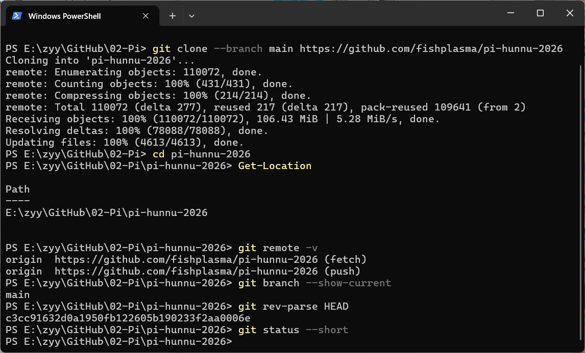
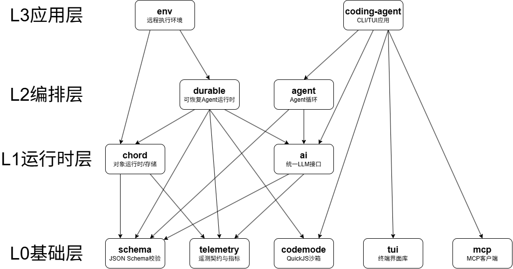

# 实践课2：组织建仓与源码分析

## 一、源码获取

已从小组组织仓库成功克隆源码，并确认了当前的远端地址与版本状态。

**实际 clone 地址：** `https://github.com/fishplasma/pi-hunnu-2026.git`

## 二、模块分析表

本人重点分析了 `coding-agent`、`agent` 和 `ai` 这三个核心模块，并与其他组员协作核对了整体依赖关系。

| 子文件夹       | 代码主要实现什么功能                                                | 本模块 build 执行什么、生成什么                                   | 直接依赖哪些内部模块                                 | 依据文件或代码位置                                   |
| -------------- | ------------------------------------------------------------------- | ----------------------------------------------------------------- | ---------------------------------------------------- | ---------------------------------------------------- |
| `telemetry`    | 负责收集、上报运行时的遥测数据和错误日志。                          | 使用 `tsc` 编译，输出到 `dist/` 目录。                            | 无                                                   | `package.json` 的 scripts 和 dependencies            |
| `schema`       | 定义整个框架使用的核心数据结构、类型定义和 Zod 校验规则。           | 使用 `tsc` 编译，输出到 `dist/`。                                 | 无                                                   | `package.json`，源码导出了大量的 Interface 和 Type   |
| `chord`        | 提供多 Agent 协作、任务编排和调度的底层通信总线。                   | 编译输出 `dist/`。                                                | `schema`                                             | `package.json`，源码中的 import 依赖                 |
| `tui`          | 终端用户界面（Terminal UI），负责渲染命令行交互界面。               | 编译输出 `dist/`。                                                | `schema`, `chord`                                    | 源码中大量引入 UI 组件和底层数据                     |
| `codemode`     | 提供代码解析、语法树（AST）操作或代码生成能力。                     | 编译输出 `dist/`。                                                | `schema`                                             | `package.json` 中的依赖声明                          |
| `mcp`          | 实现 Model Context Protocol，用于连接外部工具和数据源。             | 编译输出 `dist/`。                                                | `schema`                                             | 负责处理外部工具的配置和生命周期                     |
| `ai`           | 封装底层大模型（LLM）的 API 调用、流式输出和 Prompt 处理。          | 编译输出 `dist/`。                                                | `schema`                                             | 核心的 AI 接口封装层                                 |
| `durable`      | 提供持久化存储、状态保存和断点恢复功能。                            | 编译输出 `dist/`。                                                | `schema`                                             | 涉及数据库或文件系统读写                             |
| `env`          | 负责环境变量加载、配置管理及系统运行环境探测。                      | 编译输出 `dist/`。                                                | 无                                                   | 依赖系统环境，供上层模块调用                         |
| `agent`        | 定义 Agent 的核心生命周期、记忆管理和工具调用决策逻辑。             | 编译输出 `dist/`。                                                | `schema`, `ai`, `durable`, `env`                     | 依赖 AI 能力，并需要持久化记忆                       |
| `coding-agent` | 终端入口（CLI）及顶层逻辑，整合所有子模块，实现完整的编程辅助功能。 | 依赖子模块构建完成后，打包 CLI 产物（可能使用 tsup 或 esbuild）。 | `agent`, `tui`, `ai`, `telemetry`, `codemode`, `mcp` | 根目录/子模块的 `package.json` 及入口文件 `index.ts` |

## 三、模块层级与依赖关系图

**层级划分依据说明：**
本图统一采用“**使用方 → 被依赖方**”的箭头方向。根据源码架构，系统被清晰划分为四个层级：

1. **L0 基础层**：包含 `schema`、`telemetry`、`tui`、`codemode`、`mcp`。它们是最底层的基石，不依赖任何其他内部模块，为上层提供数据结构、遥测、UI 组件和沙箱等基础能力。
2. **L1 运行时层**：包含 `chord` 和 `ai`。它们建立在 L0 之上，分别提供对象运行时和统一大模型接口。
3. **L2 编排层**：包含 `durable` 和 `agent`。`agent` 统筹调用 AI 接口和持久化运行时，负责 Agent 的核心决策循环；`durable` 负责可恢复的运行时状态。
4. **L3 应用层**：包含 `env` 和 `coding-agent`。`coding-agent` 作为顶层 CLI 应用，整合调用 L0-L2 的所有能力；`env` 提供远程执行环境支持。

## 四、问题回答

**1. 根目录与子模块中的 `npm run build` 分别读取什么配置、执行什么工作？**

- **子模块的 `npm run build`**：通常读取自身目录下的 `tsconfig.json`，执行 TypeScript 编译（`tsc`），将 TS 源码转译为 JS，输出到该模块自己的 `dist` 文件夹中。
- **根目录的 `npm run build`**：读取根目录的 `package.json` 和 `tsconfig`，通常使用 `turbo` 或 `lerna` 等构建工具，按拓扑顺序依次调用各个子模块的 build 脚本，最后可能还会使用打包工具（如 `tsup`）将 `coding-agent` 连同依赖打包成一个可独立执行的 CLI 文件。

**2. 构建顺序和模块依赖有什么关系？相邻构建的模块是否一定互相依赖？**

- **关系**：构建顺序必须严格遵循**拓扑排序**，即“被依赖的模块必须先构建”。例如，`schema` 必须先于 `agent` 构建，否则 `agent` 在编译时会找不到类型定义。
- **相邻构建的模块不一定互相依赖**。在构建队列中相邻的模块（比如 `telemetry` 和 `schema`），仅仅是因为它们都属于底层模块、被安排了靠前的执行顺序，它们之间可能完全没有任何直接依赖关系。

**3. 选择一条涉及至少三个模块的依赖路径，说明这些模块如何分工。**

- **路径选择**：`coding-agent` → `agent` → `ai` → `schema`。
- **分工说明**：
  - `schema`：最底层，定义了 Prompt 的数据结构和模型返回结果的类型。
  - `ai`：依赖 `schema`，负责把请求格式化为标准格式，调用大模型 API，并将流式返回的数据解析成 `schema` 定义的对象。
  - `agent`：依赖 `ai` 和 `schema`，负责接收用户意图，结合上下文（Memory）构造 Prompt 交给 `ai`，并解析模型的决策以决定下一步动作（如调用工具）。
  - `coding-agent`：最顶层，依赖 `agent`，负责解析命令行参数，启动交互界面，并驱动 `agent` 开始工作。
