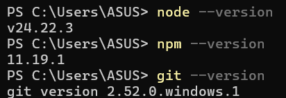
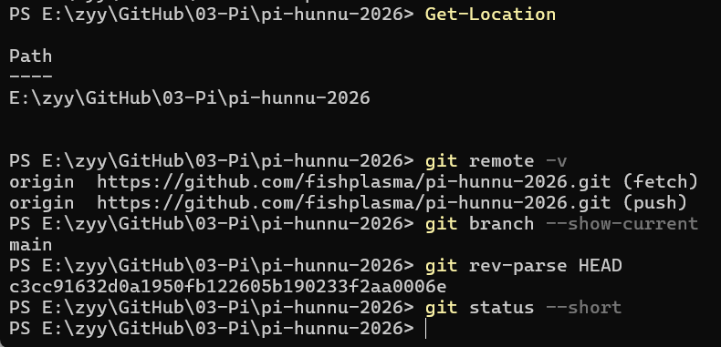
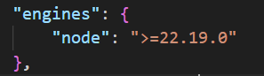
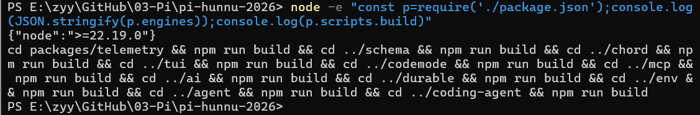
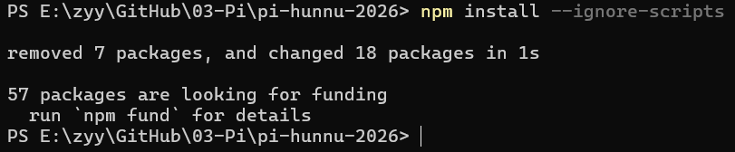
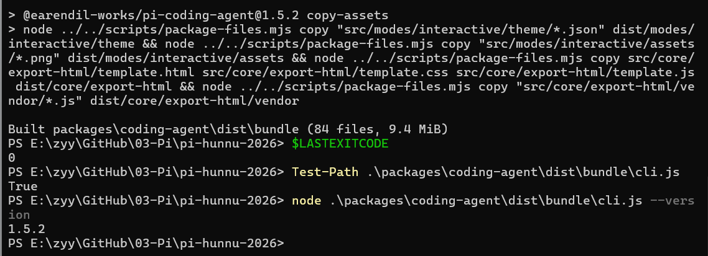
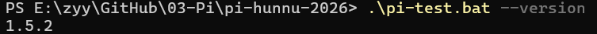
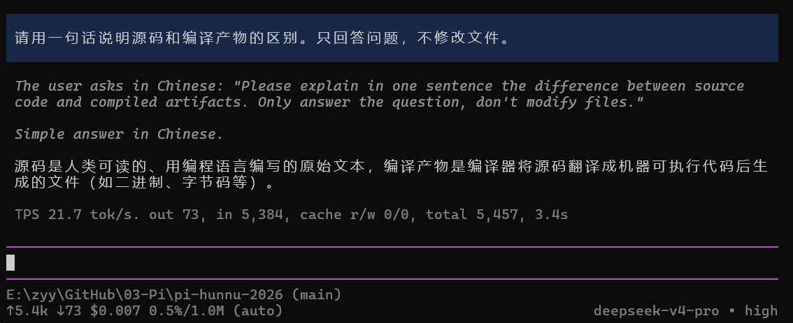
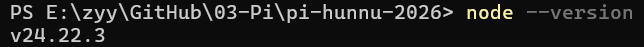

# 实践课3：Pi Agent 源码获取、依赖安装与本地编译

- 姓名：邹颜怿
- 学号：202430224027
- 小组组织内仓库：`https://github.com/fishplasma/pi-hunnu-2026.git`
- 完成时间：2026.11.22

---

## 一、实验准备：开发工具检查

在 PowerShell 中逐条执行 `node --version`、`npm --version`、`git --version`。

| 工具            | 版本                           |
| --------------- | ------------------------------ |
| Node.js         | `v24.22.3`                     |
| npm             | `11.19.1`                      |
| Git for Windows | `git version 2.52.0.windows.1` |



_图 S1：node / npm / git 三个版本。_

升级过程中的权限问题记录在第七节（困难 1、2）。

---

## 二、源码获取与版本确认

使用的是第二次实践作业中小组组织内 fork 的仓库，而不是教师组织仓库：

```powershell
cd E:\zyy\GitHub\03-Pi
git clone --branch main https://github.com/fishplasma/pi-hunnu-2026.git
cd pi-hunnu-2026
```

版本确认结果：



_图 S2：当前目录、`git remote -v`、当前分支、`git rev-parse HEAD`。_

---

按任务要求查看了仓库根目录的以下位置：

| 文件或目录                           | 观察到的内容                                                                                                                                                                      |
| ------------------------------------ | --------------------------------------------------------------------------------------------------------------------------------------------------------------------------------- |
| `README.md`                          | `Development` 小节给出 `npm install --ignore-scripts`、`npm run build`、`npm run build:offline`、`npm run check`、`./test.sh`、`./pi-test.sh`                                     |
| `package.json`                       | `engines.node` = `>=22.19.0`；`workspaces` = `packages/*`、`apps/*` 及若干示例目录；`devDependencies` 含 TypeScript、esbuild、vitest、biome、husky                                |
| `package-lock.json`                  | `lockfileVersion: 3`，共 470 个条目：440 个 registry 包（其中 125 个为可选/按平台安装）+ 30 个工作区包                                                                            |
| `packages/`                          | telemetry、schema、chord、tui、codemode、mcp、ai、durable、env、agent、coding-agent 共 11 个包                                                                                    |
| `packages/coding-agent/package.json` | `"bin": { "pi": "dist/bundle/cli.js" }`；`build` = `build:unbundled`（`tsc -p tsconfig.build.json` + 拷资源）+ `node ../../scripts/build-coding-agent-bundle.mjs`（esbuild 打包） |

根 `package.json` 中的两处关键定义：




_图 S3：`engines.node` 与 `scripts.build`。_

**两个问题：**

1. **Node.js 版本要求在哪里？** 在根 `package.json` 的 `engines.node` 字段（`>=22.19.0`），这是 npm 在安装时检查、不满足就报 `EBADENGINE` 的依据。但真正的下限由用到的每个包各自声明共同决定：本次 `apps\p3` 要求 `>=24.4.0`，所以实际环境必须是 Node 24。
2. **`npm run build` 实际从哪里读取命令？** 从**当前目录 `package.json` 的 `scripts.build`** 读取。这个脚本本身不编译任何东西，它只是依次 `cd` 进入 11 个子包，在每个子包里再执行该子包**自己的** `scripts.build`；真正的编译命令写在子包的 `package.json` 里（多数是 `tsc -p tsconfig.build.json`，`ai` 包额外先跑 `generate-models`，`coding-agent` 最后用 esbuild 打包）。`&&` 保证前一步成功才继续。

---

## 四、依赖安装

在仓库根目录执行：

```powershell
npm install --ignore-scripts
```

**实际输出：**



---

## 五、本地编译与构建产物验证

### 1. 首次构建

```powershell
npm run build
```



### 3. 后续重新构建

```powershell
npm run build:offline
```

复用已经生成好的模型目录数据重新编译，不联网。本次实测退出码同样为 0，末行仍是 `Built packages\coding-agent\dist\bundle (84 files, 9.4 MiB)`。它不能代替首次的联网初始化：数据缺失或过期时，仍要联网执行 `npm run build`。

---

## 六、启动本地源码版本并完成一次会话

### 1. 先验证源码入口



### 2. 启动交互界面

```powershell
.\pi-test.bat
```

发送问题：

```text
请用一句话说明源码和编译产物的区别。只回答问题，不修改文件。
```

实际收到的模型回复：

> 源码是人类可读的、用变成语言编写的原始文本，编译产物是编译器将源码翻译成机器可执行代码后生成的文件（如二进制、字节制等）。



### 3. 报告说明

**本次如何确保运行的是本地源码？** ①在本次新克隆的 `03-Pi\pi-hunnu-2026` 仓库根目录内启动；②用 `.\pi-test.bat`，它的入口是本次下载的 `packages\coding-agent\src\cli.ts`，属于源码直接执行路径；③刻意不用全局命令 `pi`，避免命中第一次实践安装的版本；④用 `node .\packages\coding-agent\dist\bundle\cli.js --version` 与 `.\pi-test.bat --version` 都得到 `1.5.2`，与本仓库 `packages\coding-agent\package.json` 的版本一致，两个入口指向同一份源码。

**源码入口与 `dist/bundle/cli.js` 入口分别适合什么场景？**

| 入口     | 命令                                              | 适合场景                                                      |
| -------- | ------------------------------------------------- | ------------------------------------------------------------- |
| 源码入口 | `.\pi-test.bat`                                   | 开发调试：改 `src` 后立刻生效，不用先构建；排查源码级问题时用 |
| 构建产物 | `node .\packages\coding-agent\dist\bundle\cli.js` | 验证构建结果、复现接近发布形态的行为与性能、给别人试用        |

---

## 七、遇到的困难与解决过程

### 困难 1：Node 版本看似满足，其实不满足

**现象。** 第一次执行 `node --version` 得到 `v22.23.2`，而根 `package.json` 写的是 `engines.node: ">=22.19.0"`，直觉上应该没问题。

**原因。** 继续查仓库才发现 `apps\p3\package.json` 声明 `"node": ">=24.4.0"`。npm 的 `EBADENGINE` 是针对每个包各自检查的，根项目的 `engines` 只是本仓库的最低门槛，不代表所有工作区和依赖都只需这个版本。课程文档也建议本次统一到 Node 24 LTS。

**解决。** 升级到 Node 24 LTS 的最新补丁版本（`v24.22.3`，附带 npm `11.19.1`）。升级后重新安装依赖，输出中不再出现任何 `EBADENGINE`。



### 困难 2（方法论）：不能只看一张图就判定构建成功

**现象。** 构建日志很长，中途出现 `Built packages\coding-agent\dist\bundle` 之前也有很多"看起来成功"的输出；只截中间一段或只看到版本号，都容易被误判为整条构建链成功。

**解决。** 按三条一起核对：①`npm run build` 的**退出码必须为 0**；②`Test-Path .\packages\coding-agent\dist\bundle\cli.js` 为 `True`；③用 `node .\packages\coding-agent\dist\bundle\cli.js --version` 得到与本仓库 `package.json` 一致的版本号 `1.5.2`，并确认 11 个包都产出了 `dist`。另外，`git status --short` 在构建后仍然干净，说明生成的模型数据与仓库里锁定的目录一致，没有意外改动源码。

---

## 八、四个问题的回答

1. **源码在哪里**：`E:\zyy\GitHub\03-Pi\pi-hunnu-2026`，来自小组组织内 fork `github.com/fishplasma/pi-hunnu-2026`，分支 `main`，提交 `c3cc91632d0a1950fb122605b190233f2aa0006e`。

2. **依赖装在哪里**：仓库根目录的 `node_modules`；workspaces 里的 11 个本地包以符号链接形式挂在 `node_modules\@earendil-works\` 下，没有在各子包里重复安装、也没有额外的锁文件。

3. **构建执行了什么**：`npm run build` 读取根 `package.json` 的 `scripts.build`，按顺序进入 11 个子包执行各自的 `build`：多数是 `tsc -p tsconfig.build.json` 编译 TypeScript；`ai` 包先运行 `catalog/generate.ts` 联网生成模型目录数据并校验；`coding-agent` 最后用 esbuild 打包成单文件 `dist\bundle\cli.js`。

4. **正在运行哪个版本**：`1.5.2`——`node .\packages\coding-agent\dist\bundle\cli.js --version` 与 `.\pi-test.bat --version` 均输出 `1.5.2`，与 `packages\coding-agent\package.json` 的版本一致。
