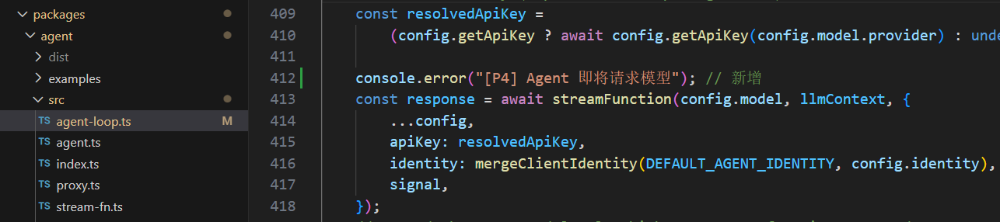
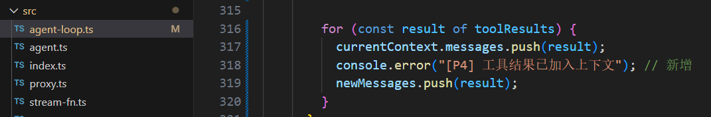
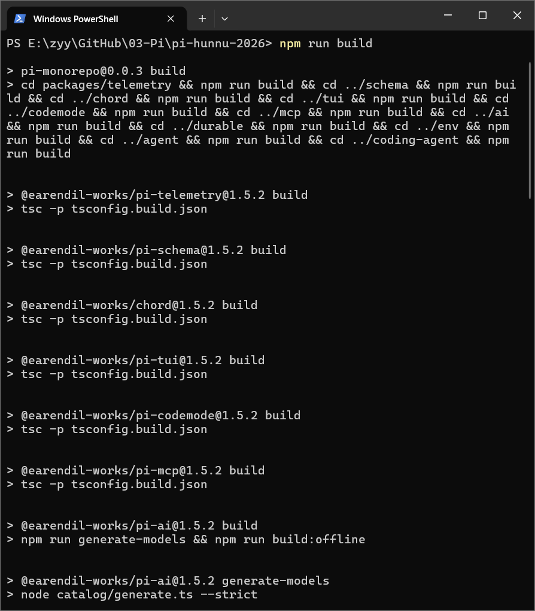
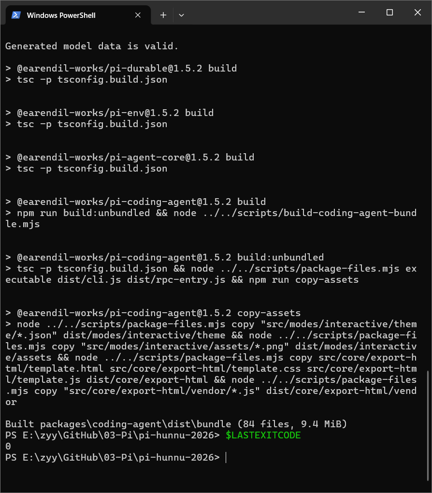
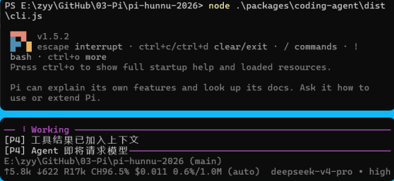
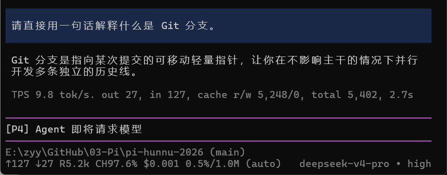
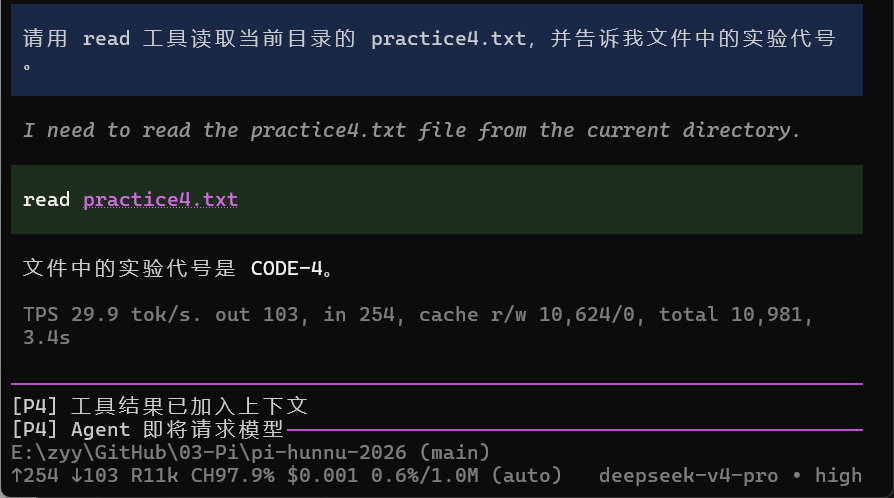

# 实践课4：Pi Agent 的模型调用与运行流程

- 姓名：邹颜怿
- 学号：202430224027
- 小组组织内仓库：`https://github.com/fishplasma/pi-hunnu-2026.git`
- 完成时间：2026.11.24

---

## 一、源码修改

在 `packages/agent/src/agent-loop.ts` 中插入两行 `console.error`。





## 二、重新编译与启动

保存源码后，在仓库根目录重新构建：

```powershell
npm run build
$LASTEXITCODE   # 0
```




直接启动本次编译出的产物（不是全局 `pi`）：

```powershell
node .\packages\coding-agent\dist\cli.js
```



## 三、两次会话的实际记录

### 会话 A：直接问答

| 项目         | 记录                                                                                       |
| ------------ | ------------------------------------------------------------------------------------------ |
| 输入指令     | `请直接用一句话解释什么是 Git 分支。`                                                      |
| 是否调用工具 | 否                                                                                         |
| `[P4]` 日志  | `[P4] Agent 即将请求模型`                                                                  |
| 模型调用轮数 | **1 轮**                                                                                   |
| 最终回复     | Git 分支是指向某次提交的可移动轻量指针，让你在不影响主干的情况下并行开发多条独立的历史线。 |



### 会话 B：读取文件

| 项目         | 记录                                                                               |
| ------------ | ---------------------------------------------------------------------------------- |
| 输入指令     | `请用 read 工具读取当前目录的 practice4.txt，并告诉我文件中的实验代号。`           |
| 是否调用工具 | 是，调用 1 次 `read`，参数 `path = practice4.txt`，读到内容 `CODE-4`               |
| `[P4]` 日志  | ①`[P4] Agent 即将请求模型` ②`[P4] 工具结果已加入上下文` ③`[P4] Agent 即将请求模型` |
| 模型调用轮数 | **2 轮**                                                                           |
| 最终回复     | 文件中的实验代号是 **CODE-4**。                                                    |



### 两次对比

|                        | 会话 A 直接问答  | 会话 B 读取文件                            |
| ---------------------- | ---------------- | ------------------------------------------ |
| 模型调用轮数           | 1                | 2                                          |
| 是否执行工具           | 否               | 是                                         |
| `工具结果已加入上下文` | 0 条             | 1 条                                       |
| 日志特征               | 只有「请求模型」 | 「请求模型 → 工具结果入上下文 → 请求模型」 |

结论：日志条数和轮数由**是否发生工具调用**决定。A 只需要模型凭已有知识作答，一轮就结束；B 第一轮模型只输出"要调用 `read`"的意图，循环执行完工具后必须再请求一次模型，才会多出后面两条日志。

## 四、运行流程

**谁实际读了文件？** 模型第一轮只返回一个工具调用请求（`name = read`，`path = practice4.txt`）；真正打开文件读出 `CODE-4` 的是本地进程：`packages/agent` 的 `runLoop` 调起 `packages/coding-agent` 里实现的 `read` 工具（`packages/coding-agent/src/core/tools/read.ts`）。

**下一轮模型请求多带了什么？** 相对于第一轮，第二轮的上下文里多了两条消息：①本轮 assistant 的 `toolCall`（工具名 `read` 与参数），②对应的 `toolResult`（`read` 的返回内容 `CODE-4`）。这正是 `[P4] 工具结果已加入上下文` 与紧接着的 `[P4] Agent 即将请求模型` 之间的因果关系：

### 架构简图


模型服务在进程之外：本地只负责拼上下文、发请求、执行工具；`[P4]` 日志记录的是本地循环到达"请求模型"和"写入工具结果"这两个位置的时刻，因此能直接从日志条数读出模型被请求了几次。
